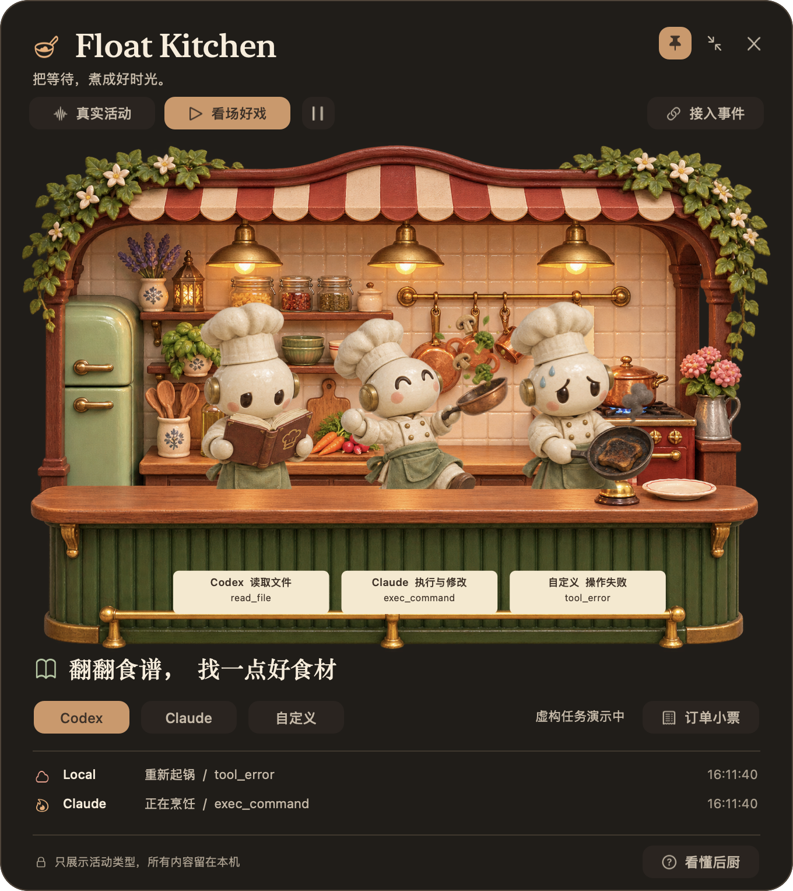

# Float Kitchen · AI 后厨

把本地 AI 客户端的活动，煮成桌面上的一场好戏。

Float Kitchen 是原生 macOS 悬浮应用。厨师的八种姿势分别对应读取、搜索、执行、测试、等确认、失败、完成与休息；工位牌和订单小票告诉你实际发生了什么。



[产品与下载](https://harnessloom.com/float-kitchen/) · [下载预览版](https://github.com/jokeuncle/float-kitchen/releases/latest) · [动作说明书](docs/动作说明书.md)

## 安装与开始

1. 在 Releases 下载适合 Apple 芯片 Mac 的 DMG 或 ZIP。要求 macOS 14 或更新。
2. 将 **Float Kitchen.app** 拖入 Applications 后打开。本预览版采用本地签名，**未经过 Apple 公证**。首次打开若被系统阻止，请确认下载来源，再按系统「隐私与安全性」中提供的操作处理；不要关闭系统保护。
3. 首次打开是明确标注的「看场好戏」演示。点击「看懂后厨」可逐项查看动作和活动的对应关系。
4. 点击「真实活动」，只读监听 Codex 与 Claude 的近期本地会话日志。真实支持取决于客户端暴露的事件与日志格式。

三个厨师从左到右代表 Codex、Claude 和自定义事件。点击厨师或下方名称切换当前关注的客户端。右上角可置顶、收成迷你厨房或隐藏；菜单栏的平底锅可找回窗口。可拖动，位置会保存。

本轮已使用真实 `codex exec` 对账。Claude 有格式适配与样例回归，未做本轮实跑。没有近期记录时，厨房保持安静。

## 看见什么

| 活动 | 厨师动作 |
|---|---|
| 读取文件 | 捧食谱 |
| 搜索资料或代码 | 提食材袋 |
| 执行与修改 | 翻锅 |
| 运行检查 | 掀盖看火候 |
| 等待明确确认 | 指向服务铃 |
| 显式工具失败 | 糊锅冒烟 |
| 客户端报告本轮结束 | 端盘上菜 |
| 暂无近期事件 | 喝杯咖啡 |

工位牌显示活动、工具名或受限的文件/命令信息；「订单小票」保留最近六步，文本可选择复制。完成事件表示客户端本轮结束，不代替任务质量验收。两分钟没有新事件会休息，不表示任务必然结束。

常见语言测试命令、客户端脚本包装调用与嵌套退出码都有针对性识别；完整范围见[动作说明书](docs/动作说明书.md)。自定义脚本、别名和动态拼装命令不能保证全部细分，会显示通用执行。

## 隐私与开销

- 本地运行，不提供上传服务，不需要 API Key。
- 自动来源只提取活动类型、时间、工具名、文件名或命令类别，不展示对话正文、私有推理、工具输出、完整路径和命令参数。
- Swift + AppKit + Core Animation，无第三方运行时。图片解码后缓存；动画由合成器运行，没有逐帧 Swift 重绘循环。
- 隐藏、完全遮挡、休眠时停止连续效果；遵循系统「减弱动态效果」。日志每两秒在后台增量读取，缓冲、历史与扫描均有上限。
- 本机性能记录见[验收说明](docs/PERFORMANCE.md)；测量不代表所有机器上的表现，也不把显示回调当作 GPU 实际帧率。

应用独立运行，不依赖其他活动记录产品。项目默认不注册登录启动、不修改 AI 客户端设置。

## 从源码构建

需要 Apple 芯片 Mac、macOS 14+、Xcode Command Line Tools（Swift）。

```sh
git clone https://github.com/jokeuncle/float-kitchen.git
cd float-kitchen
zsh scripts/build-kitchen.sh
open 'build/Float Kitchen.app'
```

```sh
swift run KitchenCoreChecks
'build/Float Kitchen.app/Contents/MacOS/FloatKitchen' --self-check --exit-after-check
'build/Float Kitchen.app/Contents/MacOS/FloatKitchen' --integration-check --exit-after-check
```

`--performance-report /absolute/path/report.json` 采样约8秒；`--preview-dir /absolute/path/previews` 导出原生界面检查图。诊断参数不改变默认数据处理。

## 接入自定义客户端

通过应用「接入事件」打开本地事件目录，或选择另一个持续追加的 JSONL 文件。无需开放端口或修改客户端设置。

```sh
python3 scripts/kitchen-event.py reading --client Local --tool read_file
python3 scripts/kitchen-event.py cooking --client Local --label '正在构建项目'
python3 scripts/kitchen-event.py served --client Local
```

默认文件：`~/Library/Application Support/FloatKitchen/events.jsonl`。每条事件独占一行并以换行结束，时间建议使用 ISO8601。

```json
{"id":"unique-id","timestamp":"2026-11-09T12:00:00Z","client":"Local","event":"testing","tool":"test","label":"运行项目检查"}
```

`event` 支持 `idle / reading / searching / cooking / testing / waiting / failed / served`；`client` 为 `Codex / Claude / Local`。`label` 是客户端主动提供的说明，最多90字符，只应传入希望在小票中展示的内容。

## 素材与文档

运行时场景使用自主生成的 `kitchen.png` 和八姿势 `chef-states.png`；`chefs.png` 用于生成应用图标。精确生成提示词与 PNG 元数据保留来源信息。角色先裁成独立纹理，避免串格；工位牌与动画分层，长文案按字体测量后省略。

[产品说明](docs/PRODUCT.md) · [视觉规范](docs/DESIGN.md) · [动作说明](docs/动作说明书.md) · [性能与验证](docs/PERFORMANCE.md)
